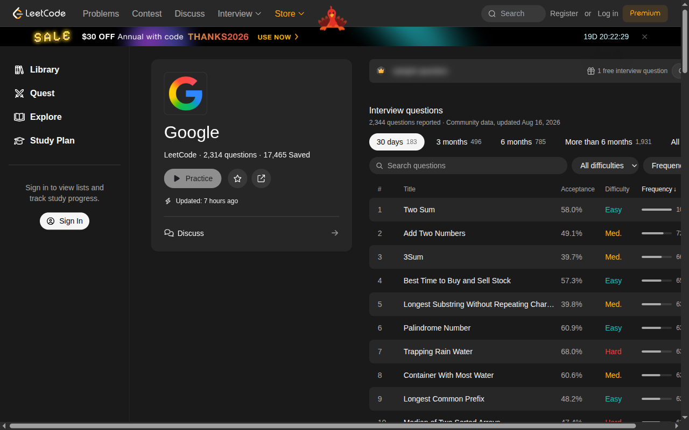
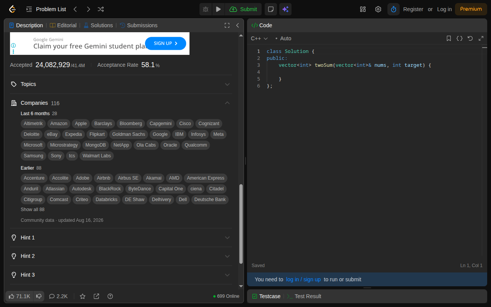
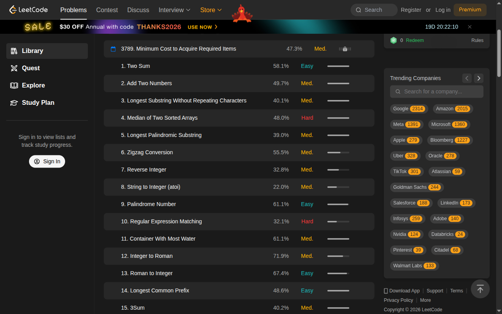

# LeetCode Enhancer

[](https://github.com/Satyam709/LeetcodeEnhancer)

Community-powered company interview data for leetcode.com. It is rendered inside LeetCode's own pages and designed to look like part of the site.

[Report Bug](https://github.com/Satyam709/LeetcodeEnhancer/issues) · [Request Feature](https://github.com/Satyam709/LeetcodeEnhancer/issues)

---

## Features

The extension only changes parts of LeetCode that are locked behind Premium. Everything else stays native, and Premium subscribers see LeetCode exactly as before.

- **Company pages** (`/company/{slug}`): the Premium wall is replaced with the company's question list. It has 30-day, 3-month, 6-month, older and all-time tabs, search, a difficulty filter, sortable columns, and a frequency bar for each question.
- **Problem pages:** the locked **Companies** chip and accordion item work again. They list the companies that asked the problem, grouped by how recently they asked it. Each company links to its company page.
- **Problem lists** (`/problemset`, `/problem-list/*`): the locked frequency bars are filled with a derived frequency score from the community data. Rows we have no data for keep LeetCode's own widget.
- **Light and dark themes:** everything uses LeetCode's own colour tokens and follows the site theme.







## Privacy

- No telemetry, analytics or tracking of any kind.
- A snapshot of the data ships inside the extension and works offline.
- Once a day the extension checks this repository's public `data` branch for newer data. It asks the GitHub API for the branch's latest commit and downloads changed files from jsDelivr. Nothing about you or your LeetCode account is sent. You can turn this off with **Auto-update company data** in the popup, and the extension then uses only the bundled snapshot.
- Permissions: `storage` saves the popup settings, and `alarms` schedules the daily check. No host permissions are needed.

## Data

Company data comes from the community-maintained [liquidslr/leetcode-company-wise-problems](https://github.com/liquidslr/leetcode-company-wise-problems) repository and is converted into compact JSON. A weekly GitHub Action (`.github/workflows/sync-data.yml`) rebuilds and validates it, then publishes it to the `data` branch whenever it changes. Installed extensions pick up the new data within a day, without a new release. The popup shows the date of the data in use and has a **Check now** button.

---

## Installation

Download the latest `leetcode-enhancer-chrome-v*.zip` or `leetcode-enhancer-firefox-v*.zip` from the [Releases](https://github.com/Satyam709/LeetcodeEnhancer/releases) page.

### Chrome / Edge / Brave

1. Extract the zip to a folder.
2. Open `chrome://extensions` and turn on **Developer mode**.
3. Click **Load unpacked** and select the extracted folder.

### Firefox (140+)

1. Open `about:debugging#/runtime/this-firefox`.
2. Click **Load Temporary Add-on…** and select the zip, or `manifest.json` in the extracted folder.

Temporary add-ons are removed when Firefox restarts.

### Popup

Pin the extension and open its popup to toggle **Highlight injected changes**. This draws green outlines around everything the extension adds, which helps when reporting issues. The popup also has the **Auto-update company data** toggle and a **Check now** button.

---

## Development

Requires Node.js 22+ and pnpm.

```bash
pnpm install
pnpm data:sync        # download the source repo and build data/ (gitignored)
pnpm build            # unpacked Chrome build in dist/
pnpm build:firefox    # unpacked Firefox build in dist/
pnpm dev              # rebuild on change
pnpm package          # minified builds in dist/<browser>/ and zips in releases/
pnpm typecheck
pnpm test
```

To see debug logs on leetcode.com, run `localStorage.setItem("lce:debug", "1")` in the DevTools console. The manual release checklist is in [`docs/dev/manual-qa.md`](./docs/dev/manual-qa.md).

---

## Contributing

Issues and pull requests are welcome. Please run `pnpm typecheck` and `pnpm test` before opening a PR. If you change an injected view, also go through the manual QA checklist.

## License

Released under the [MIT License](https://opensource.org/licenses/MIT).

## Disclaimer

LeetCode Enhancer is an unofficial project. It is not endorsed by or affiliated with LeetCode. Company data is community-reported and may be incomplete or out of date.

---

## Changelog

### v3.0.0

- Rewritten in TypeScript as a Manifest V3 extension for Chrome and Firefox.
- Company data comes from a bundled community dataset instead of a Google Sheet, and there is no telemetry.
- Company lists render on the real company page, and the Companies chip and accordion on problem pages work again. Problem lists show a derived frequency.
- Every surface matches LeetCode's own styling in light and dark themes, and survives LeetCode re-rendering the page.
- Premium problem statements and editorials are no longer included.

### v2.0.0

- Firefox support, editorial access, modular refactor.

### v1.0.0

- Initial release.
